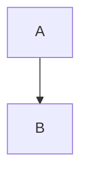

# C1 — System Context

Thin pointer. Source of truth: `docs/architecture/workspace.dsl` view `SystemContext`. Validate with `structurizr validate -workspace docs/architecture/workspace.dsl`. Structurizr Lite is EOL — use the CLI for validation. Do not duplicate the diagram here.

